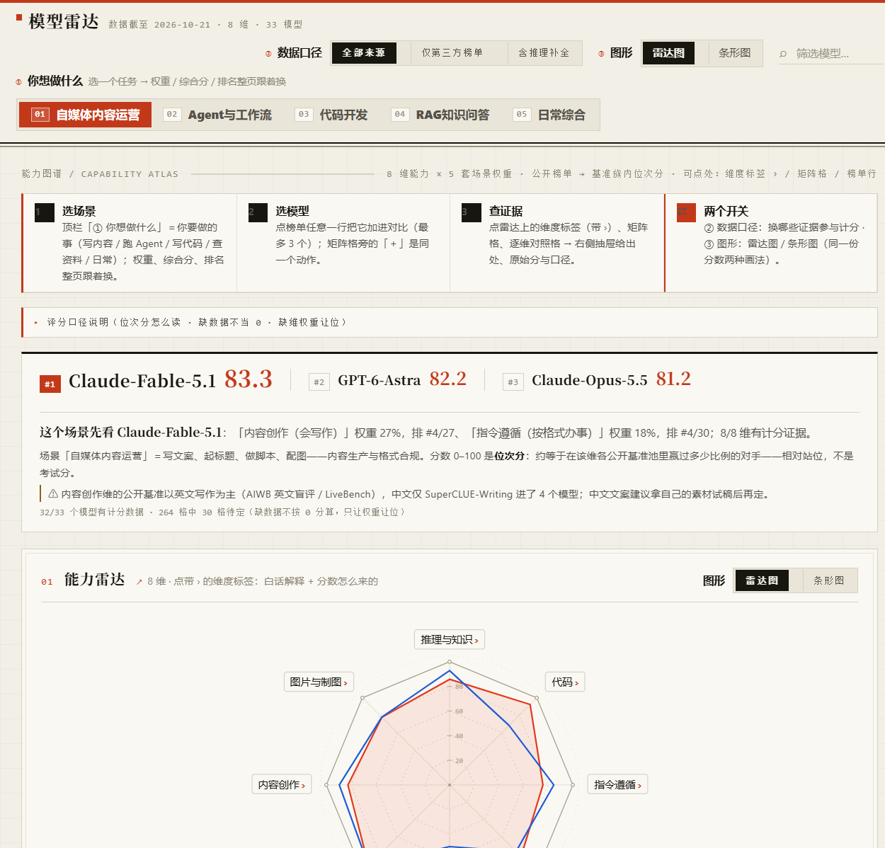

# 模型雷达图 · Model Radar

**按场景选模型，而不是按一张总榜选模型。**

把公开榜单折算成 8 个能力维度，按任务场景加权；没有证据的维度留白，不拿 0 分代替。

[](LICENSE)
[](DATA_LICENSE.md)
[](https://www.python.org/)
[](https://github.com/Brando-2077/model-radar/actions/workflows/validate.yml)

[在线体验](https://Brando-2077.github.io/model-radar/) · [方法论](docs/methodology.md) · [数据与算法](docs/data-and-algorithms.md) · [数据来源](docs/data-sources.md) · [参与贡献](CONTRIBUTING.md) · [English overview](README.en.md)



---

## 为什么做这个项目

我们并不缺模型榜单。缺的是一个在具体任务面前，能帮你把“谁更强”翻译成“哪个更适合我”的视角。

每个榜单都在自己的题目、自己的量表、自己的模型池里回答同一个问题；把它们的分直接平均，得到的往往不是能力，而是噪声。于是这个项目做了三件看起来不讨巧、但更接近真实决策的事：

1. **先分维度，再谈综合。** 推理、代码、指令遵循、Agent、长文本、可靠性、内容创作、图片与制图——不同任务需要的不是同一把尺子。
2. **只在同一基准内比名次。** 不把 GPQA 的 80 分和 Terminal-Bench 的 80 分当成同一种 80 分；先归入基准族，再问“在这个基准的模型池里，它赢过多少对手”。
3. **缺数据就留白。** 没有证据的维度不画到圆心、不按 0 分计入综合分；页面会明确告诉你“待定”，而不是用一个看起来精确的数字替你做决定。

它不替你做决定，只把决定的依据摊开：分数来自哪个基准、池子有多大、覆盖了几个维度、是不是只有单一来源。

**初心**：做一个只呈现可复核公开证据的模型选择工具，让“选模型”这件事少一点玄学，多一点诚实。

更完整的项目立意见 [docs/vision.md](docs/vision.md)。

## 它是什么

- **8 维能力雷达**：推理与知识、代码、指令遵循、Agent 与工具调用、长文本、可靠性与低幻觉、内容创作、图片与制图。
- **5 套场景权重**：自媒体内容运营、Agent 与工作流、代码开发、RAG 知识问答、日常综合。
- **三档数据口径**：全部来源 / 仅第三方榜单 / 含推理补全。页面只切换口径，不重算分数。
- **诚实处理缺失**：雷达断口、条形图斜纹、矩阵“待定”；缺维权重让位，而不是当 0。
- **可点开每条证据**：来源名称、数据日期、原始分、基准族、族内人数、位次分公式；原始 URL 保留在 `data/raw_*.csv`。
- **单文件交付**：`model-radar.html` 自带数据与交互，双击即开、离线可用、零运行时依赖。

截至 2026-10-21，账本包含 **729 条证据 / 33 个模型 / 669 条计分证据 / 44 个基准族 / 234 个有分格子**（其中 13 条推理补全，默认不计分）。这些数字会随数据更新变化，以页面和 `data/scores.csv` 为准。

## 快速开始

### 直接看

下载或克隆仓库，双击 `model-radar.html`。不需要安装、不需要联网。

也可以直接打开[在线版本](https://Brando-2077.github.io/model-radar/)。

### 本地构建

要求 Python 3.10+。

```bash
python -m pip install -r requirements.txt
python build.py
```

一条命令跑完两阶段：先从 `data/raw_*.csv` 重建证据账本 `data/scores.csv`，再把账本与维度、权重、名册写进 `model-radar.html` 的数据区（`--scores` / `--html` 可分步）。

### 校验

```bash
python scripts/validate.py
```

校验会检查维度、权重、映射、账本去重、HTML 数据区、模型名册与关键计数。GitHub Actions 也会在每次推送和 PR 时运行同样的检查。

## 数据口径（先读这三条）

1. **榜单分 = 基准族内位次分。** 同一基准族内，把原始分从低到高排序，最低分记第 1 名；位次分 = `(名次 - 0.5) / n × 100`。原始分越高，名次越靠后、位次分越高。分数越高，表示在该基准的模型池里赢过的对手越多；n 越大越接近 0–100 两端（n=4 时约为 12.5–87.5）。
2. **小族降权入分。** 族内 ≥4 个模型全权计分，3 个 ×0.6、2 个 ×0.35（低置信证据按可信度参与，不一刀切排除）；仅 1 个模型的族不计分（无对手不可排名）。
3. **维度分 = 该维各计分族位次分的算术均值。** 综合分按场景权重加权；缺数据的维度权重自动让位，不按 0 分处理。

同一（模型 × 基准族）只留一票：第三方证据优先，日期新者优先；AA 的 Terminal-Bench 同模型只取一版，优先 4.0，缺则回退 2.1。

完整规则、去重、三档口径、推理补全与已知限制见 [方法论](docs/methodology.md)；逐条来源、44 个计分族、当前快照与复现步骤见 [数据与算法全解](docs/data-and-algorithms.md)。

## 项目结构

```text
.
├─ model-radar.html          # 唯一交付物：单文件网页（数据内联）
├─ build.py                  # CLI 入口（python build.py 一条命令重建）
├─ radar/                    # 构建管线包：config/tables/normalize/families/aggregate/ledger/emit
├─ tests/                    # pytest 测试套件
├─ data/
│  ├─ raw_*.csv              # 各来源原始证据（带 URL 与数据日期）
│  ├─ mapping.csv            #（来源, 类别）→ 维度 + 基准族
│  ├─ canon.csv              # 榜单模型名 → 项目统一名
│  ├─ models.csv             # 模型名册与展示元数据
│  ├─ dimensions.csv         # 8 维定义、白话解释、典型任务
│  ├─ weights.csv            # 5 套场景 × 8 维相对权重
│  └─ scores.csv             # 生成的证据账本（勿手改）
├─ scripts/
│  ├─ validate.py            # 数据与 HTML 一致性校验
│  ├─ infer_gaps.py          # 推理补全（默认不计分）
│  └─ fetch_*.py             # 按需抓取，不保留持久缓存
├─ docs/                     # 方法论、架构、数据源、加模型指南
└─ .github/                  # CI、Issue / PR 模板
```

## 参与贡献

欢迎三类贡献：

- **数据纠错**：分数抄错、版本对不上、来源失效、基准族归并错误。请附原始页面 URL、数据日期和截图/原文。
- **补新模型 / 新基准**：先读 [加模型指南](docs/adding-models.md)，按表格逐项填写。
- **页面与文档**：可读性、可访问性、移动端、图表表达、错别字都欢迎。

提交前请跑：

```bash
python build.py --scores
python build.py --html
python scripts/validate.py
```

并确认 `git diff` 里同时包含数据表与 `model-radar.html` 的同步变化。

贡献规则、数据纪律与 PR 清单见 [CONTRIBUTING.md](CONTRIBUTING.md)。

## 数据来源与致谢

当前证据来自以下公开来源（按来源名排序）：

- [Artificial Analysis](https://artificialanalysis.ai)
- [LiveBench](https://livebench.ai)（含 LiveBench 2.0）
- [LMArena](https://lmarena.ai)
- [Design Arena](https://openrouter.ai/rankings#benchmarks)（经 OpenRouter 公开接口）
- [SuperCLUE](https://www.superclueai.com)
- [AIWB — AI Writing Benchmark](https://aiwritingbenchmark.com/leaderboard)
- [AI产品狙击手](https://www.techgogogo.com/llm-benchmark/)（techgogogo.com）
- 各厂商官方发布材料（DeepSeek / 智谱 / 腾讯 / 小红书等，逐条标注渠道）
- [酥悠沫](https://suyoumo.github.io/)（仅用于补缺；官方转录与第三方聚合分开标记）

每条 raw 证据都保留来源 URL 与数据日期；厂商自报渠道在“仅第三方榜单”口径下整体排除。详细说明与各来源的局限见 [docs/data-sources.md](docs/data-sources.md)。

感谢所有公开 benchmark 的维护者、参与人评的匿名用户，以及愿意把模型卡和评测结果公开出来的团队。没有这些公开证据，这个项目无法成立。

## 免责声明

- 本项目不是任何模型厂商、评测机构或榜单的官方项目。
- 所有分数都是**当期模型池内的相对位次分**，不是绝对能力值；增减模型会让全池分数整体移动。
- 榜单覆盖、题目难度、评测 harness、模型版本、采样温度等都会影响结果；请结合原始来源与自己的任务实测。
- 推理补全值默认不计入维度分；即使打开“含推理补全”，它们也只是估计值，不是实测。
- 本项目不构成采购、投资或生产选型建议；高风险场景请自行验证。

## License

- **代码**（`*.py`、`model-radar.html` 的展示壳与交互逻辑）：[MIT](LICENSE)
- **数据与文档**（`data/` 中的整理、归一化结果与本文档）：[CC BY 4.0](DATA_LICENSE.md)

上游榜单与模型卡的数据版权归原发布方所有；使用前请阅读各来源的使用条款。`DATA_LICENSE.md` 说明了本仓库能够授予的范围。
