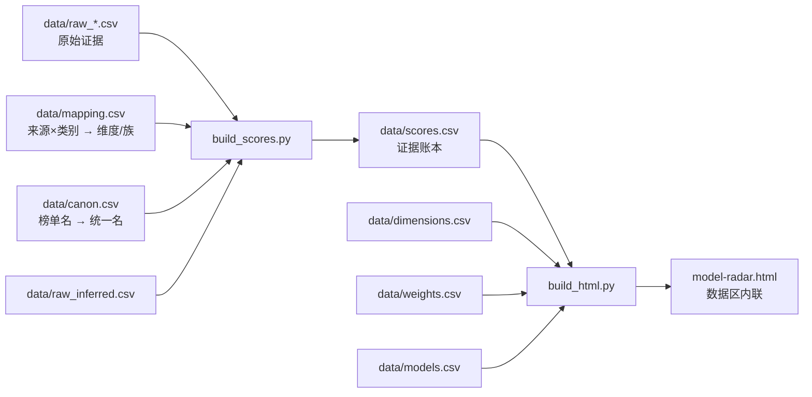

# 架构与数据流

本文面向想改代码或补数据的贡献者。产品口径与公式见 [方法论](methodology.md)，这里只讲“东西放在哪、怎么流动”。

## 1. 目录结构

```text
.
├─ model-radar.html          # 唯一交付物：HTML/CSS/JS 展示壳 + 内联数据区
├─ build_scores.py           # 原始证据 → 证据账本
├─ build_html.py             # 证据账本 + 维度/权重/名册 → HTML 数据区
├─ data/
│  ├─ raw_*.csv              # 各来源原始证据（每行带 URL 与数据日期）
│  ├─ raw_inferred.csv       # 推理补全（列结构与 raw_* 不同，单独处理）
│  ├─ mapping.csv            #（来源, 类别）→ 维度 + 基准族
│  ├─ canon.csv              # 榜单模型名 → 项目统一名
│  ├─ models.csv             # 模型名册：公司 / 开源 / 数据日期 / 备注
│  ├─ dimensions.csv         # 8 维定义、白话解释、典型任务、适用建议
│  ├─ weights.csv            # 5 套场景 × 8 维相对权重
│  └─ scores.csv             # 生成的证据账本（勿手改）
├─ scripts/
│  ├─ validate.py            # 数据与 HTML 一致性校验
│  ├─ infer_gaps.py          # 推理补全（默认不计分）
│  ├─ fetch_model.py         # 抓 AA 单模型页
│  ├─ fetch_or_rankings.py   # 抓 OpenRouter / Design Arena 榜
│  ├─ append_design_arena.py # 追加 Design Arena 行
│  ├─ diff_aa.py             # AA 全 slug 记录 ↔ 账本差集
│  ├─ extract_aa.py          # 从存档页提字段
│  ├─ parse_push.py          # Next.js RSC payload 提取
│  └─ scan_aa.py             # 扫 AA 页面字段
├─ docs/                     # 方法论、架构、数据源、加模型、FAQ
├─ .github/                  # CI 与 Issue / PR 模板
├─ index.html                # GitHub Pages 入口（跳转到 model-radar.html）
├─ requirements.txt
├─ LICENSE                   # MIT（代码）
├─ DATA_LICENSE.md           # CC BY 4.0（整理数据与文档）
└─ README.md
```

公开仓库不包含内部工作笔记、历史备份、页面抓取缓存与 `data/archive/` 旧版页面；这些只留在本地，避免把过程性内容当成产品文档。

## 2. 主数据流



### 2.1 `build_scores.py`

职责：

1. 读取 `data/raw_*.csv`（排除 `raw_inferred.csv`）；
2. 用 `canon.csv` 把各榜单模型名统一；
3. 用 `mapping.csv` 把（来源, 类别）映射到维度与基准族；
4. 按量纲做第一步归一化（0–1 ×100、0–10 ×10、Elo/指数池内 min–max 到 60–100）；
5. Terminal-Bench 同族去重（优先 TB4.0，缺则 TB2.1）；
6. 按（模型 × 族）去重：第三方优先、日期新者优先；
7. 计算族内位次分，写入 `scores.csv`；
8. 追加 `raw_inferred.csv` 的推理值（`族` 为空，默认不计分）。

输出列：`模型, 维度, 榜单分, 备注, 族, 族内n`。

`族内n < 4` 的行保留面值与真实人数，页面过滤并标“样本不足”；推理行的 `族` 与 `族内n` 为空。

### 2.2 `build_html.py`

职责：

1. 从 `build_scores.py` 导入 `CANON`、`FAMILY_MIN_N`、`VENDOR_SRC`，保证口径同源；
2. 读取 `scores.csv`、`dimensions.csv`、`weights.csv`、`models.csv`；
3. 过滤计分证据（`族内n ≥ 4`），按维度求均值；
4. 同时计算三档口径：全部来源、仅第三方、含推理补全；
5. 计算场景综合分、覆盖度、单基准标记 `sf/sfTp`；
6. 把账本、证据明细、维度、权重、场景、模型写成一个 JSON，整体覆盖 `model-radar.html` 的数据区。

### 2.3 `model-radar.html`

这是唯一交付物。文件里只有一处机器生成区：

```html
<!-- ==== 数据区 BEGIN ... ==== -->
<script>window.RADAR_LEDGER = {...}</script>
<!-- ==== 数据区 END ==== -->
```

数据区由 `build_html.py` 整体覆盖，**不要手改**；其余 HTML / CSS / JS 是手写展示壳，可以改。改完壳后重新跑一次 `build_html.py`，确认数据区仍能正常写入。

页面没有运行时依赖：不加载 CDN、不需要网络、不需要构建工具；双击即可打开。

## 3. 构建与验证

### 3.1 本地构建

```bash
python -m pip install -r requirements.txt
python build_scores.py
python build_html.py
python scripts/validate.py
```

`build_scores.py` 会打印基准族去重、未映射类别、计分覆盖等诊断信息。看到“既未映射、也未声明有意不映射”的提示时，补 `mapping.csv`，不要忽略。

### 3.2 构建日期与幂等

`model-radar.html` 的 `meta.built` 使用构建当天日期。因此：

- **同一天**连续构建，输出字节级一致；
- **跨天**构建，即使数据没变，HTML 也会因日期变化而不同。

这不是 bug。跨天提交时，只需确认 `git diff` 里数据区的内容变化符合预期。`scores.csv` 不受构建日期影响，可以逐字节复现。

### 3.3 校验脚本

`scripts/validate.py` 检查：

- 8 个维度与 5 套场景是否齐全；
- 场景权重是否可归一、维度是否都存在；
- `mapping.csv` 是否覆盖所有 raw（来源, 类别）；
- `scores.csv` 的模型是否都在名册、维度是否都存在；
- 计分行（`族内n ≥ 4`）是否同一（模型 × 族）只有一票；
- 未计分行与推理行是否保留；
- HTML 数据区 JSON 是否可解析、模型/证据/场景计数是否与账本一致；
- 关键计数（模型数、证据数、计分数、族数、覆盖格数）是否打印出来供人工复核。

### 3.4 CI

`.github/workflows/validate.yml` 在 push / PR 时：

1. 安装 `requirements.txt`；
2. 运行 `build_scores.py`，并检查 `data/scores.csv` 是否与提交版本一致（忽略行尾差异）；
3. 运行 `scripts/validate.py`；
4. 对 Python 文件做语法编译检查。

CI 不重建 `model-radar.html`，因为它内置构建日期；页面构建由贡献者在本地完成并随 PR 提交。

## 4. 加一个新来源

1. 在 `data/` 新增 `raw_<source>.csv`，列与现有 raw 表一致：
   `模型, 公司, 来源, 类别, 原始分, 量纲, 数据日期, URL`；
2. 在 `data/canon.csv` 增加榜单模型名 → 统一名的别名；
3. 在 `data/mapping.csv` 增加（来源, 类别）→ 维度 + 基准族的行；
   - 不打算映射的总分/综合指数：维度留空，明确声明“有意不映射”；
4. 如果来源是厂商自报，把来源名加入 `build_scores.py` 的 `VENDOR_SRC`，并补 `VENDOR_SRC_PAGES`；
5. 跑 `build_scores.py`，检查诊断输出与 `scores.csv`；
6. 跑 `build_html.py` 与 `validate.py`；
7. 在 `CHANGELOG.md` 记录来源、日期、行数与口径影响。

### 4.1 抓取脚本的边界

`scripts/fetch_*.py` 是“按需抓取”工具，不参与主构建，也不保留持久缓存：

- 网站改版、反爬、登录态都可能导致脚本失效；
- 抓下来的页面/快照不要提交到仓库；
- 入库前必须人工核对至少一个字段，不能把脚本输出直接当成真值；
- 每条 raw 行必须带 URL 与数据日期。

## 5. 加一个新模型

完整流程见 [adding-models.md](adding-models.md)。最小检查清单：

- `models.csv` 有名册行；
- raw 表有证据行（或明确标记“待定/无公开证据”）；
- `canon.csv` 有榜单名别名；
- 新来源/新类别才需要动 `mapping.csv`；
- `build_scores.py` 无“未映射”警告；
- `build_html.py` 后页面能选中该模型；
- `validate.py` 通过；
- PR 同时包含数据表与 `model-radar.html`。

## 6. 常见故障

| 现象 | 可能原因 | 处理 |
|---|---|---|
| 页面模型数比名册多 | raw 里有已移除模型的残留行，且 canon 没命中 | 搜 raw 模型名，删残留；跑 validate |
| 某维一直“待定” | 该维没有计分族，或只有厂商自报（第三方口径） | 看抽屉的族与 n；补第三方证据，或接受待定 |
| 分数与上次差很多 | 池子增减导致位次整体移动 | 看相对名次与覆盖，不要逐格比较绝对值 |
| `build_scores.py` 提示未映射 | 新来源/类别没进 mapping | 补 mapping 行，或声明有意不映射 |
| HTML 数据区没更新 | 没跑 `build_html.py`，或数据区标记被破坏 | 恢复 BEGIN/END 标记，重跑 |
| CI 报 `scores.csv` 不一致 | 改了 raw/mapping/canon 但没重建账本 | 本地跑 `build_scores.py` 并提交 |

## 7. 兼容性

- Python 3.10+；
- 构建依赖仅 `pandas`；
- 页面面向现代浏览器（Chrome / Edge / Firefox / Safari 近两年版本）；
- 不依赖 Web 字体、CDN、后端服务；
- 移动端可读，但完整矩阵表在窄屏需要横向滚动。
